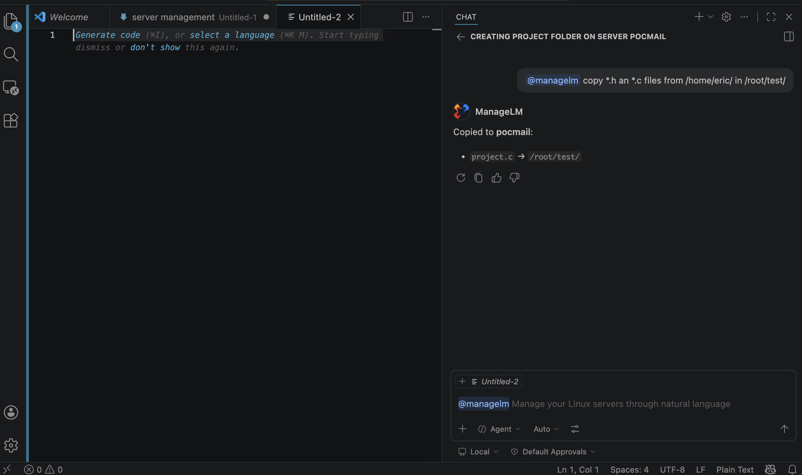

<p align="center">
  <a href="https://www.managelm.com">
    
  </a>
</p>

<h3 align="center">VS Code Extension</h3>

<p align="center">
  Manage Linux &amp; Windows servers from VS Code Copilot Chat using natural language.
</p>

<p align="center">
  <a href="LICENSE"></a>
  <a href="https://www.managelm.com"></a>
  <a href="https://www.managelm.com/plugins/vscode.html"></a>
  <a href="https://github.com/managelm/vscode-extension/releases"></a>
</p>

<p align="center">
  
</p>

---

Type `@managelm` in Copilot Chat to check system status, manage packages, configure services, run security audits, search your fleet, and more. The extension connects Copilot to your infrastructure through the ManageLM portal and lightweight agents on your servers, with nearly all the tools ManageLM gives Claude through MCP.

## Features

- **Natural language** — describe tasks in plain English; the extension picks the right tool
- **34 built-in tools** — modelled on the ManageLM MCP tools: tasks, scans, 13 fleet searches, hosting connectors and actions, task history and revert
- **Interactive tasks** — when the agent needs input, Copilot asks you and answers automatically
- **Scans that wait** — security, inventory, access, certificate and activity scans return their result
- **Cross-infrastructure search** — agents, inventory, security issues, activity, SSH keys, sudo, certificates, monitors, backups, credentials, keystore, cloud resources
- **Copilot native** — works inside Copilot Chat, no separate UI

## Quick Start

### 1. Install

From the VS Code Marketplace:

```bash
code --install-extension managelm.managelm
```

Or download the `.vsix` from [GitHub Releases](https://github.com/managelm/vscode-extension/releases).

### 2. Configure

1. In the ManageLM portal, go to **Settings > MCP & API > API Keys** and create a key. It acts as you, limited to the authorizations you tick: add **Assets** for scans, **Hosting** for VM actions, **Credentials** / **Keystore** to search those
2. Open VS Code **Settings** (`Cmd+,` / `Ctrl+,`) and search for **ManageLM**
3. Set your **API Key**, and your **Portal URL** if self-hosting

### 3. Use it

Open Copilot Chat and type `@managelm` followed by your request:

```
@managelm show me all my servers

@managelm check disk usage on web-prod-01

@managelm install nginx on web-staging-02

@managelm run a security audit on db-primary

@managelm which servers have CPU above 80%?

@managelm who logged in to db-primary yesterday?

@managelm which certificates expire this month?
```

## Architecture

```
VS Code Copilot Chat ── REST API ──> ManageLM Portal ── WebSocket ──> Agent on Server
  @managelm                          (cloud control      (outbound      (skill exec)
                                      plane)              only)
```

No SSH, no inbound ports on your servers.

## Available Tools

| Tool | Description |
|------|-------------|
| `search_agents` | Servers by status, group, site, health or text |
| `get_agent_info` | One server: OS, health, skills, recent tasks |
| `get_agent_skills` / `list_available_skills` | Skills on a server / catalog skills not yet imported |
| `get_account_info` / `list_team_members` | Account, groups and sites / team members |
| `search_inventory` / `search_security` / `search_activity` | Inventory, security issues (audits, pentests, threats), logins and sudo |
| `search_ssh_keys` / `search_sudo_rules` | Access across the fleet, mapped to your team |
| `search_certificates` / `search_pki` | Certificates found on servers / certificates ManageLM issues |
| `search_monitors` / `search_backups` | Monitors with current status / backups and their last run |
| `search_credentials` / `search_keystore` | Rotating credentials / keystore keys and usage (metadata only) |
| `list_connectors` / `search_cloud` / `get_cloud_info` | Hosting connectors and the resources they discover |
| `cloud_action` | Start, stop, reboot or snapshot a VM (disruptive actions need your confirmation) |
| `run_security_audit` / `run_inventory_scan` / `run_access_scan` / `run_certificate_scan` / `run_activity_scan` | Run a scan on one server and wait for the result |
| `run_task` | Run a skill-based task on one server (`auto` lets the agent pick the skill) |
| `answer_task` / `follow_up_task` | Answer a task waiting for input / continue a conversation |
| `get_task_status` / `get_task_history` / `get_task_changes` / `revert_task` | Task results, history, file changes and revert |

Tasks and scans run on one server at a time. Scheduled tasks are not covered: MCP's `search_schedules` has no counterpart here. On an account set to No LLM, `run_task`, `answer_task`, `follow_up_task` and `get_agent_skills` are unavailable; searches and scans still work. Approving agents, users, API keys and webhooks are managed in the portal.

## Requirements

- **VS Code 1.99+** with GitHub Copilot Chat
- **ManageLM account** — [sign up free](https://app.managelm.com/register) (up to 10 agents)
- **ManageLM Agent** — installed on each server you want to manage
- **API Key** — from Portal > Settings > MCP & API

## Development

```bash
npm install        # install dependencies
npm run build      # compile TypeScript
npm run watch      # watch mode
npm run package    # create .vsix
```

## Other Integrations

- [Claude Code Extension](https://github.com/managelm/claude-extension) — MCP integration for Claude
- [ChatGPT Plugin](https://github.com/managelm/openai-gpt) — manage servers from ChatGPT
- [n8n Plugin](https://github.com/managelm/n8n-plugin) — infrastructure automation workflows
- [Slack Plugin](https://github.com/managelm/slack-plugin) — notifications and commands in Slack
- [OpenClaw Plugin](https://github.com/managelm/openclaw-plugin) — OpenClaw integration

## Links

- [Website](https://www.managelm.com)
- [Full Documentation](https://www.managelm.com/plugins/vscode.html)
- [Portal](https://app.managelm.com)

## License

[Apache 2.0](LICENSE)
